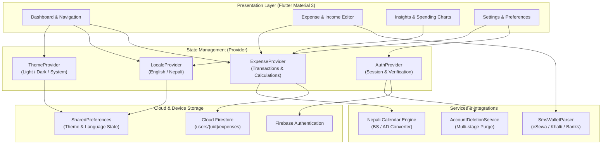

<div align="center">

# 🌿 Pocket

### Personal Finance, Budgeting & Expense Tracking for Nepal & Beyond

An intuitive, beautifully crafted personal finance application engineered for real everyday life in Nepal. Track expenses and income, manage monthly budgets, parse digital wallet and bank SMS alerts, analyze spending habits, and seamlessly switch between Bikram Sambat (BS) and Gregorian (AD) calendars in English or Nepali.

[](https://github.com/bibasshrestha980-npl/expense_tracker/actions/workflows/ci.yml)
[](https://github.com/bibasshrestha980-npl/expense_tracker/actions/workflows/security.yml)


_%7C_AD-00796B)
[](LICENSE)

<br/>

[Overview](#-overview) &nbsp;•&nbsp; [Screenshots](#-screenshots) &nbsp;•&nbsp; [Features](#-core-features) &nbsp;•&nbsp; [Smart AI & Automation](#1-ai--smart-automation) &nbsp;•&nbsp; [Architecture](#-architecture) &nbsp;•&nbsp; [Run Locally](#-quick-start--setup) &nbsp;•&nbsp; [Security](#-security--data-integrity)

</div>

---

## 🌟 Overview

Managing personal money in Nepal comes with unique daily dynamics: navigating both **Bikram Sambat (वि.सं.)** and **Gregorian (AD)** calendars, spending across physical cash and digital wallets (**eSewa, Khalti, Fonepay**), and switching between English and native Nepali.

**Pocket** is designed from the ground up to address these realities. Built with **Flutter (Material 3)**, **Provider**, and **Google Cloud Firestore**, Pocket delivers a fluid cross-platform experience across Web, Desktop, Android, and iOS—combining zero-friction logging with deep visual insights, localized financial intelligence, and strict owner-isolated security.

---

## 📸 Screenshots

<div align="center">

| Light Mode (Overview & Analytics) | Dark Mode (Overview & Analytics) |
|:---:|:---:|
|  |  |

*High-fidelity Material 3 presentation featuring responsive navigation, instant balance computation, daily spending distribution, and category breakdowns.*

</div>

---

## 🚀 Core Features

Pocket provides a complete, modern suite of personal money management tools—available **100% free and open-source**:

### 1. AI & Smart Automation
* **Smart SMS & Digital Wallet Parser (eSewa / Khalti / Bank SMS):**
  * Paste transaction SMS alerts from commercial banks (e.g., Nabil, NIC Asia, Global IME, Sanima) or digital wallets (eSewa, Khalti, Fonepay).
  * Automatically detects transaction amount, type (Income vs. Expense), merchant/store title, date, and pre-selects the appropriate category with one click.
* **Context-Aware Category Suggestions:**
  * Context-sensitive suggestions for all 14 categories in both English and Nepali.
  * Instant auto-generation based on the selected category and current time of day (e.g., morning tea, lunch/khaja, dinner, microbus fare, internet recharge).
  * Smooth horizontal scrollable suggestion chips supporting touch, trackpad drag, mouse wheel, and navigation arrows.
* **AI Financial Coach & Spending Insights:**
  * Summarizes spending velocity and flags sudden spikes in recurring discretionary categories.
  * Provides conversational feedback on month-to-date budget pacing.
* **Receipt & Bill Scanner (Vision OCR):**
  * Architecture-ready image intake for parsing photo receipts and printed supermarket invoices.

### 2. Advanced Budgeting & Goal Management
* **Category Budgets with Dynamic Alerts:**
  * Establish monthly spending limits per category (e.g., *Food & Dining: Rs. 15,000*, *Shopping: Rs. 8,000*).
  * Real-time color-coded progress bars (🟢 Normal $\rightarrow$ 🟡 Caution at 80% $\rightarrow$ 🔴 Overspent at 100%).
* **Savings Goals & Sinking Funds:**
  * Track custom financial milestones (e.g., *Dashain Celebration Fund*, *Emergency Reserves*, *Gadget Upgrades*, *Vacation Savings*).
  * Dedicated progress rings tracking target dates and accumulated amounts.
* **Recurring Transactions & Subscriptions:**
  * Schedule fixed monthly commitments (house rent, fiber internet, gym dues, streaming services, and monthly salary).

### 3. Multi-Account & Wallet Architecture
* **Multiple Wallets & Ledger Separation:**
  * Track isolated balances for **Cash in Hand**, **Bank Accounts**, and **Digital Wallets (eSewa, Khalti)**.
  * Inter-wallet fund transfers with automated double-entry ledger balance updates.
* **Debts & Loans Tracker (उधारो / Udharo Ledger):**
  * Keep track of money lent to friends and borrowed obligations.
  * Record partial repayments, due dates, and settlement status.
* **Multi-Currency Converter:**
  * Log foreign purchases in USD, EUR, INR (भारतीय रुपैयाँ), AUD, or GBP with automated conversion to NPR.

### 4. Professional Analytics & Reporting
* **Interactive Visualization:**
  * Daily spending activity bar charts showing monthly pace.
  * Proportionate category distribution bars with percentage contribution metrics.
* **Executive PDF & CSV Reports:**
  * Generate formatted monthly financial statements ready for business reimbursements, tax documentation, or personal records.
  * One-click clipboard copy of tabular CSV transaction logs.
* **Search, Filtering & Sorting:**
  * Instant full-text search across titles and notes.
  * Filter by category, transaction type (Income vs. Expense), or calendar month.
  * Sort by newest, oldest, or highest amount.

### 5. Localization, Privacy & Security
* **Bilingual English & Nepali Interface:**
  * Complete native Nepali translation (`नेपाली`) across every screen, dialog, navigation destination, and alert.
  * Instant language toggle with persistent storage via `SharedPreferences`.
* **Dual Calendar Engine (Bikram Sambat BS & Gregorian AD):**
  * Switch between BS (`वि.सं.`) and AD (`ई.सं.`) at any time without altering underlying date timestamps.
  * Full Nepali month names (बैशाख, जेठ, असार, ..., चैत) and festival/tithi metadata integration.
* **Strict Privacy & Owner Isolation:**
  * Cloud Firestore Security Rules enforce strict ownership: authenticated users can only query, modify, or delete their own data under `users/{uid}/...`.
  * Secure multi-stage account deletion service for permanent data eradication.
* **Integer Paisa Precision:**
  * Financial amounts are stored internally as integer paisa (1 Rupee = 100 Paisa), guaranteeing zero floating-point accumulation errors during financial calculations.

---

## 🏗️ Architecture & Data Flow

Pocket is engineered with clean separation of concerns, decoupling UI presentation from state management and cloud persistence:



### Transaction Storage Schema

Every transaction is stored as a isolated document in Cloud Firestore:

```text
users/{uid}/expenses/{expenseId}
  ├── title: String          (e.g., "Lunch with friends")
  ├── category: String       (e.g., "Food", "Transport", "Salary")
  ├── amountCents: Integer   (Paisa representation, e.g., 25000 = Rs 250.00)
  ├── date: Timestamp        (UTC transaction timestamp)
  ├── note: String           (Optional detailed note)
  └── isIncome: Boolean      (true = Income, false = Expense)
```

---

## 💻 Quick Start & Setup

### Prerequisites

| Tool | Version Requirement |
| :--- | :--- |
| **Flutter SDK** | `^3.13.0` or higher (matching [pubspec.yaml](pubspec.yaml)) |
| **Dart SDK** | Included with Flutter SDK |
| **Firebase CLI** | `firebase-tools` for rules deployment and emulator testing |
| **FlutterFire CLI** | For platform initialization (`flutterfire configure`) |
| **Chrome / Browser** | For local web development |
| **Android / iOS** | Android Studio & SDK, or macOS with Xcode for iOS builds |

### 1. Clone & Install Dependencies

```bash
git clone https://github.com/bibasshrestha980-npl/expense_tracker.git
cd expense_tracker
flutter pub get
```

### 2. Configure Firebase

1. Create a project in the [Firebase Console](https://console.firebase.google.com/).
2. Enable **Cloud Firestore** and **Authentication** (Email/Password, Google, and Anonymous).
3. Connect your project locally via FlutterFire CLI:
   ```bash
   firebase login
   flutterfire configure --project=YOUR_FIREBASE_PROJECT_ID
   ```
4. Deploy the production security rules:
   ```bash
   firebase deploy --only firestore:rules --project=YOUR_FIREBASE_PROJECT_ID
   ```

### 3. Run the Application

```bash
# Run on Web (Chrome)
flutter run -d chrome

# Run on connected Android / iOS device
flutter devices
flutter run -d <DEVICE_ID>
```

---

## 🧪 Testing & Quality Assurance

Pocket maintains strict code health and automated test coverage across unit, widget, and database security rule layers:

```bash
# 1. Run static analysis (0 warnings / 0 lints)
flutter analyze

# 2. Run automated test suite (80+ unit, widget, and provider tests)
flutter test

# 3. Build production web bundle
flutter build web --release
```

### Security Rule Testing

Firestore security rules are validated using the Firebase Local Emulator Suite to guarantee cross-tenant isolation and verify authorization rules:

```bash
npm ci --prefix security
firebase emulators:exec --only firestore --project demo-pocket-security --config firebase.security.json "npm --prefix security test"
```

---

## 📁 Project Structure

```text
expense_tracker/
├── lib/
│   ├── l10n/                 # Localization ARB files & auto-generated delegates
│   │   ├── app_en.arb        # English translations
│   │   └── app_ne.arb        # Nepali translations
│   ├── models/               # Domain models (Expense, CalendarPeriod, etc.)
│   ├── providers/            # State management (ExpenseProvider, AuthProvider, LocaleProvider)
│   ├── screens/              # UI screens & dialogs
│   │   ├── auth_screen.dart       # Sign-in, sign-up, password reset
│   │   ├── dashboard.dart         # Main desktop/mobile adaptive dashboard
│   │   ├── expense_editor.dart    # Expense/Income creation form with AI suggestions
│   │   ├── nepali_picker.dart     # Bikram Sambat date selector
│   │   ├── report_dialog.dart     # Financial statement & CSV export modal
│   │   ├── settings_screen.dart   # Appearance, language, account controls
│   │   └── spending_stories.dart  # Visual spending stories & calendar highlights
│   ├── services/             # Core business services & external integrations
│   │   ├── account_deletion_service.dart  # Multi-stage user data cleanup
│   │   ├── nepali_calendar_service.dart   # BS/AD calendar engine
│   │   └── repositories/                  # Firestore abstraction layer
│   ├── main.dart             # Application root & theme configuration
│   └── theme.dart            # Material 3 typography and dark/light color schemes
├── test/                     # Unit, widget, and integration tests
├── security/                 # Automated Firestore rules test suite
├── docs/                     # Documentation, guides & visual screenshots
└── firestore.rules           # Cloud Firestore access control rules
```

---

## 🛡️ Security & Data Integrity

* **Zero-Trust Access Control:** No document can be read or written without authenticated identity matching the URL path (`request.auth.uid == userId`).
* **Input Validation in Rules:** Every transaction write is validated at the database layer for data type correctness, positive integer amounts, and mandatory fields.
* **Privacy by Design:** Transactions are stored under the user's private document tree and are never aggregated or shared across tenants.
* For vulnerability reporting, see [SECURITY.md](SECURITY.md).

---

## 🤝 Contributing

Contributions, feedback, and pull requests are welcomed! To propose enhancements, fixes, or new calendar features:
1. Review the [Contributing Guidelines](CONTRIBUTING.md).
2. Check [Troubleshooting Guide](docs/TROUBLESHOOTING.md) for common development hurdles.
3. Open an issue or submit a pull request with test coverage.

---

## 📄 License

This project is open-source software licensed under the **[MIT License](LICENSE)**.

<div align="center">
Made with ❤️ for smart personal finance in Nepal.
</div>
