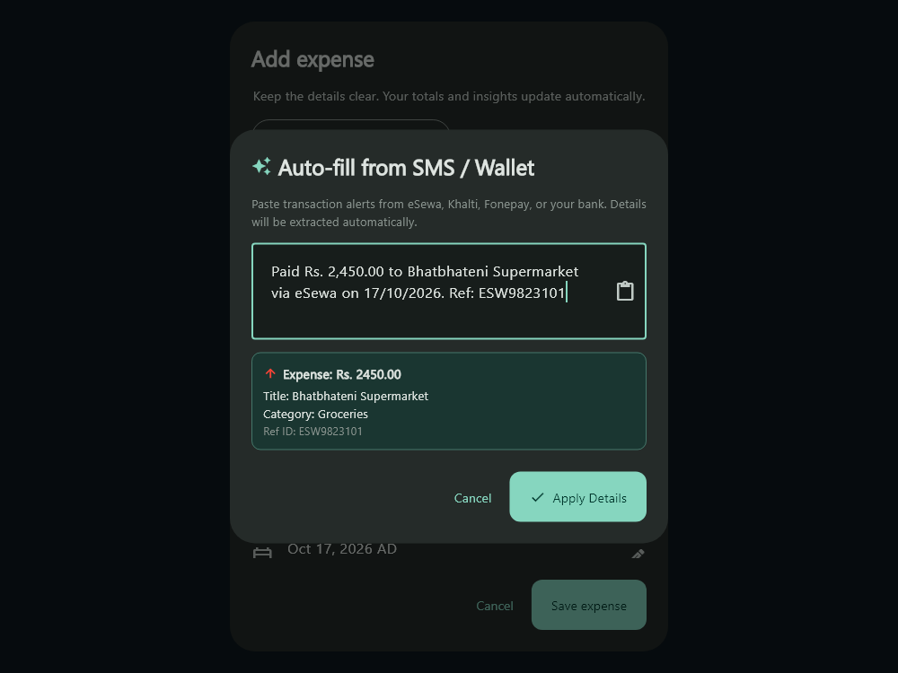
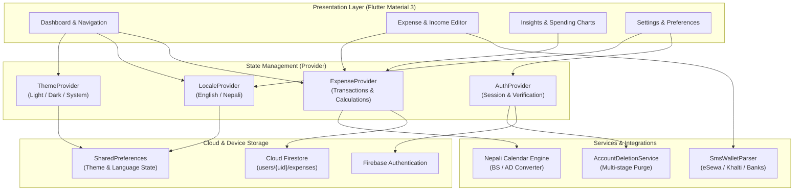

<div align="center">

# 🌿 Pocket

### Personal Finance & Expense Tracking for Nepal & Beyond

An intuitive personal finance application for everyday life in Nepal. Track expenses and income, parse digital wallet and bank SMS alerts, review spending, and switch between Bikram Sambat (BS) and Gregorian (AD) calendars in English or Nepali.

[](https://github.com/bibasshrestha980-npl/expense_tracker/actions/workflows/ci.yml)
[](https://github.com/bibasshrestha980-npl/expense_tracker/actions/workflows/security.yml)


_%7C_AD-00796B)
[](LICENSE)

<br/>

[Overview](#-overview) &nbsp;•&nbsp; [Screenshots](#-screenshots) &nbsp;•&nbsp; [Features](#-core-features) &nbsp;•&nbsp; [Architecture](#-architecture) &nbsp;•&nbsp; [Run Locally](#-quick-start--setup) &nbsp;•&nbsp; [Security](#-security--data-integrity)

</div>

---

## 🌟 Overview

Managing personal money in Nepal comes with unique daily dynamics: navigating both **Bikram Sambat (वि.सं.)** and **Gregorian (AD)** calendars, spending across physical cash and digital wallets (**eSewa, Khalti, Fonepay**), and switching between English and native Nepali.

**Pocket** is designed from the ground up to address these realities. Built with **Flutter (Material 3)**, **Provider**, and **Google Cloud Firestore**, Pocket delivers a fluid cross-platform experience across Web, Desktop, Android, and iOS—combining zero-friction logging with deep visual insights, localized financial intelligence, and strict owner-isolated security.

---

## 📸 Screenshots

<div align="center">

| Light Mode (Overview & Analytics) | Dark Mode (Overview & Analytics) |
|:---:|:---:|
|  |  |

<br/>

| Smart SMS & Digital Wallet Auto-Fill (eSewa / Khalti / Bank SMS) |
|:---:|
|  |

*Material 3 screens showing the dashboard, spending breakdowns, and SMS import flow.*

</div>

---

## Core Features

Pocket provides an open-source set of personal money management tools:

### 1. Transaction Tracking & SMS Import
* **Expenses and income:** Record, edit, search, filter, and sort transactions.
* **SMS and wallet parser:** Paste bank or wallet alerts. The parser reads amounts only when it finds a currency marker or clear transaction keyword, and suggests a supported category. Review imported fields before saving.
* **Title suggestions:** Pick context-sensitive suggestions from the selected category.

### 2. Spending Overview & Reports
* **Dashboard:** Review period income and expenses, all-time balance, daily spending, and category breakdowns.
* **PDF and CSV reports:** Export period summaries and transaction logs.

### 3. Localization, Privacy & Security
* **English and Nepali interface:** Switch languages with the setting saved on the device.
* **BS and AD calendars:** Browse transactions using Bikram Sambat or Gregorian calendar periods.
* **Owner-isolated data:** Firestore rules restrict each account to its own records. Account deletion includes a multi-stage data purge.
* **Integer paisa storage:** Transaction amounts are stored as integer paisa for precise totals.

---

## 🏗️ Architecture & Data Flow

Pocket is engineered with clean separation of concerns, decoupling UI presentation from state management and cloud persistence:



### Transaction Storage Schema

Every transaction is stored as an individual document in Cloud Firestore:

```text
users/{uid}/expenses/{expenseId}
  ├── title: String          (e.g., "Lunch with friends")
  ├── category: String       (e.g., "Food", "Transport", "Salary")
  ├── amountCents: Integer   (Paisa representation, e.g., 25000 = Rs 250.00)
  ├── date: Timestamp        (UTC transaction timestamp)
  ├── note: String           (Optional detailed note)
  └── type: String      ("income" or "expense")
```

---

## 💻 Quick Start & Setup

### Prerequisites

| Tool | Version Requirement |
| :--- | :--- |
| **Flutter SDK** | `^3.13.0` or higher (matching [pubspec.yaml](pubspec.yaml)) |
| **Dart SDK** | Included with Flutter SDK |
| **Firebase CLI** | `firebase-tools` for rules deployment and emulator testing |
| **FlutterFire CLI** | For platform initialization (`flutterfire configure`) |
| **Chrome / Browser** | For local web development |
| **Android / iOS** | Android Studio & SDK, or macOS with Xcode for iOS builds |

### 1. Clone & Install Dependencies

```bash
git clone https://github.com/bibasshrestha980-npl/expense_tracker.git
cd expense_tracker
flutter pub get
```

### 2. Configure Firebase

1. Create a project in the [Firebase Console](https://console.firebase.google.com/).
2. Enable **Cloud Firestore** and **Authentication** (Email/Password, Google, and Anonymous).
3. Connect your project locally via FlutterFire CLI:
   ```bash
   firebase login
   flutterfire configure --project=YOUR_FIREBASE_PROJECT_ID
   ```
4. Deploy the production security rules:
   ```bash
   firebase deploy --only firestore:rules --project=YOUR_FIREBASE_PROJECT_ID
   ```

### 3. Run the Application

```bash
# Run on Web (Chrome)
flutter run -d chrome

# Run on connected Android / iOS device
flutter devices
flutter run -d <DEVICE_ID>
```

---

## 🧪 Testing & Quality Assurance

Pocket maintains strict code health and automated test coverage across unit, widget, and database security rule layers:

```bash
# 1. Run static analysis (0 warnings / 0 lints)
flutter analyze

# 2. Run automated test suite (80+ unit, widget, and provider tests)
flutter test

# 3. Build production web bundle
flutter build web --release
```

### Security Rule Testing

Firestore security rules are validated using the Firebase Local Emulator Suite to guarantee cross-tenant isolation and verify authorization rules:

```bash
npm ci --prefix security
firebase emulators:exec --only firestore --project demo-pocket-security --config firebase.security.json "npm --prefix security test"
```

---

## 📁 Project Structure

```text
expense_tracker/
├── lib/
│   ├── l10n/                 # Localization ARB files & auto-generated delegates
│   │   ├── app_en.arb        # English translations
│   │   └── app_ne.arb        # Nepali translations
│   ├── models/               # Domain models (Expense, CalendarPeriod, etc.)
│   ├── providers/            # State management (ExpenseProvider, AuthProvider, LocaleProvider)
│   ├── screens/              # UI screens & dialogs
│   │   ├── auth_screen.dart       # Sign-in, sign-up, password reset
│   │   ├── dashboard.dart         # Main desktop/mobile adaptive dashboard
│   │   ├── expense_editor.dart    # Expense/Income creation form with AI suggestions
│   │   ├── nepali_picker.dart     # Bikram Sambat date selector
│   │   ├── report_dialog.dart     # Financial statement & CSV export modal
│   │   ├── settings_screen.dart   # Appearance, language, account controls
│   │   └── spending_stories.dart  # Visual spending stories & calendar highlights
│   ├── services/             # Core business services & external integrations
│   │   ├── account_deletion_service.dart  # Multi-stage user data cleanup
│   │   ├── nepali_calendar_service.dart   # BS/AD calendar engine
│   │   └── repositories/                  # Firestore abstraction layer
│   ├── main.dart             # Application root & theme configuration
│   └── theme.dart            # Material 3 typography and dark/light color schemes
├── test/                     # Unit, widget, and integration tests
├── security/                 # Automated Firestore rules test suite
├── docs/                     # Documentation, guides & visual screenshots
└── firestore.rules           # Cloud Firestore access control rules
```

---

## 🛡️ Security & Data Integrity

* **Zero-Trust Access Control:** No document can be read or written without authenticated identity matching the URL path (`request.auth.uid == userId`).
* **Input Validation in Rules:** Every transaction write is validated at the database layer for data type correctness, positive integer amounts, and mandatory fields.
* **Privacy by Design:** Transactions are stored under the user's private document tree and are never aggregated or shared across tenants.
* For vulnerability reporting, see [SECURITY.md](SECURITY.md).

---

## 🤝 Contributing

Contributions, feedback, and pull requests are welcomed! To propose enhancements, fixes, or new calendar features:
1. Review the [Contributing Guidelines](CONTRIBUTING.md).
2. Check [Troubleshooting Guide](docs/TROUBLESHOOTING.md) for common development hurdles.
3. Open an issue or submit a pull request with test coverage.

---

## 📄 License

This project is open-source software licensed under the **[MIT License](LICENSE)**.

<div align="center">
Made with ❤️ for smart personal finance in Nepal.
</div>
