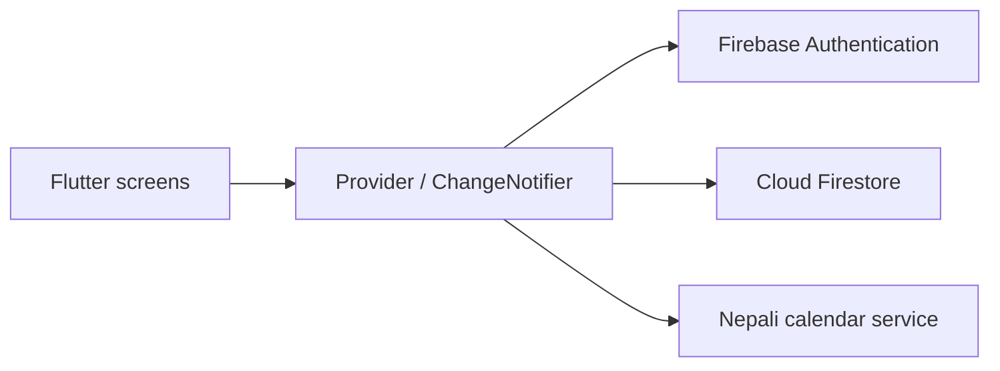

# Pocket

### Personal finance, made clear.

[](https://github.com/bibasshrestha980-npl/expense_tracker/actions/workflows/ci.yml)


[](LICENSE)

Pocket is a personal finance app for everyday tracking in Nepal. Record income and spending in NPR, switch between Bikram Sambat and Gregorian dates, and review your month through clear summaries.

Built as a Flutter final project with **Firebase Authentication**, **Provider**, and **Cloud Firestore**.

[Features](#features) · [Getting started](#getting-started) · [Architecture](#architecture) · [Contributing](CONTRIBUTING.md)

## Features

| Area | What you can do |
| --- | --- |
| Transactions | Record, edit, search, and delete income and expenses with categories and notes. |
| Overview | Review income, spending, balance, and recent transactions. |
| Insights | Explore monthly spending, category totals, and comparisons. |
| Nepali calendar | Switch between BS and AD dates and browse daily activity. |
| Calendar details | View available event and tithi data from external sources. |
| Reports | Copy financial summaries and export transactions as CSV. |
| Authentication | Email/password, Google, and guest sign-in when enabled in Firebase. |
| Storage | Firestore synchronization with user-scoped access rules. |

Amounts are stored as integer paisa to avoid floating-point rounding errors in transaction totals.

### In development

Payment reminders and share/SIP tracking are being developed locally and are not yet committed to this repository. Reminders currently use in-app alerts; investment values are manually entered snapshots.

## Getting started

### Requirements

- Flutter with **Dart 3.13 or later**, matching [pubspec.yaml](pubspec.yaml).
- Firebase CLI and FlutterFire CLI.
- Your own Firebase project.
- Chrome or a configured Android/iOS development environment.

### 1. Clone and install

```sh
git clone https://github.com/bibasshrestha980-npl/expense_tracker.git
cd expense_tracker
flutter pub get
```

### 2. Configure Firebase

```sh
firebase login
flutterfire configure --project=YOUR_PROJECT_ID
```

In Firebase Console:

1. Create a Cloud Firestore database.
2. Enable Email/Password authentication.
3. Enable Google and Anonymous authentication if you want those options.
4. Configure authorized web domains and the platform settings needed for Google sign-in.

The checked-in Firebase configuration identifies the original project. Generate your own configuration for a separate deployment.

```sh
firebase deploy --only firestore:rules --project=YOUR_PROJECT_ID
```

### 3. Run

```sh
flutter run -d chrome
```

For a device or emulator, use its actual ID:

```sh
flutter devices
flutter run -d DEVICE_ID
```

The repository includes web, Android, and iOS targets. Each needs Firebase configuration; building iOS requires macOS and Xcode.

### 4. Validate and build

```sh
flutter analyze
flutter test
flutter build web
```

Web output is written to `build/web`. Building does not automatically publish a hosted site.

## Architecture



| Path | Responsibility |
| --- | --- |
| `lib/main.dart` | Startup and authentication routing |
| `lib/models/` | Transactions, calendar periods, and summaries |
| `lib/providers/` | Authentication, data streams, and state |
| `lib/screens/` | Dashboard, forms, reports, calendar, and settings |
| `lib/services/` | Calendar API integration |
| `lib/theme.dart` | Shared visual styling |
| `firestore.rules` | Ownership and document validation |
| `test/` | Unit and widget tests |

Transactions live at `users/{userId}/expenses/{expenseId}`. Firestore rules require the authenticated user to own the path and validate document fields.

## Current limitations

- Calendar event coverage depends on the external source. Missing event data does not mean a date or transaction is missing.
- The on-screen six-digit verification flow is a **demonstration**, not production multi-factor authentication. Firebase email verification is a separate flow.
- Guest access should not be treated as a durable account across devices.
- Platform folders alone do not establish that every authentication flow has been tested on every platform.

## Contributing

See [CONTRIBUTING.md](CONTRIBUTING.md) for checks and pull request guidance. Use the issue templates for reproducible bugs or feature suggestions. Do not include real financial records, passwords, or tokens in reports.

## Acknowledgments

Built with Flutter, Firebase, Provider, and `nepali_utils`. Calendar integration uses [bibhuticoder/nepali-calendar-api](https://github.com/bibhuticoder/nepali-calendar-api).

## License

[MIT](LICENSE).
