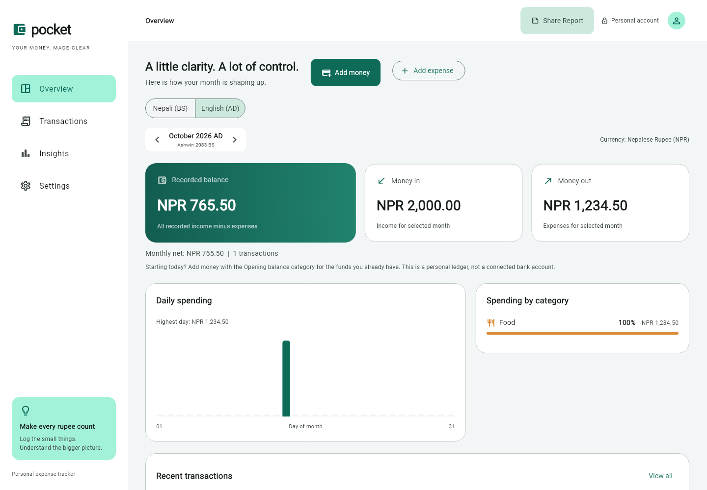
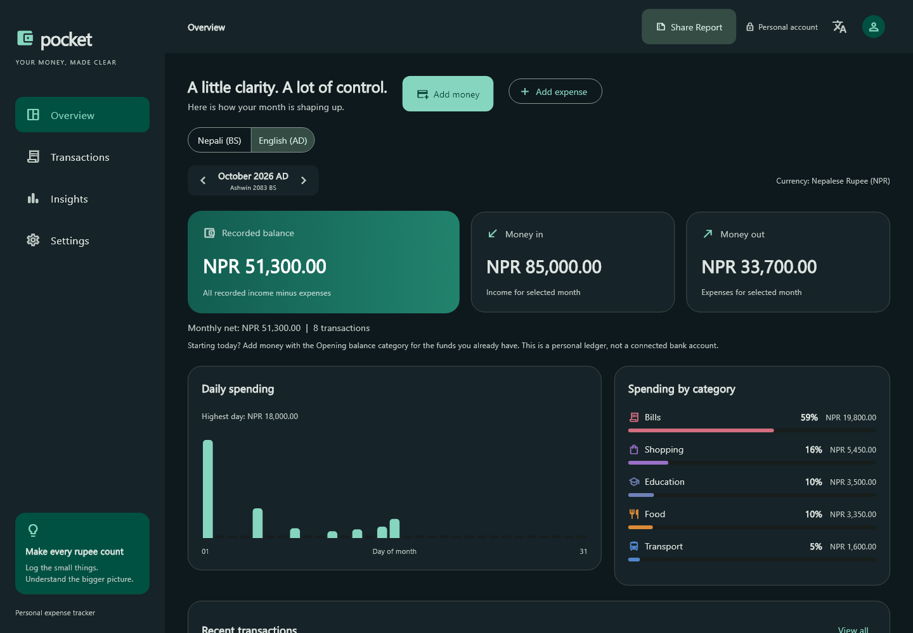

# Pocket

An expense tracker built with Flutter, Provider, and Firebase. It supports Nepali rupees, BS and AD dates, and English and Nepali interfaces.

This is a final-project app for recording daily spending and income, reviewing monthly totals, and keeping transactions under a signed-in account.

[](https://github.com/bibasshrestha980-npl/expense_tracker/actions/workflows/ci.yml)

## Screenshots

| Light mode | Dark mode |
| --- | --- |
|  |  |

Screenshots use sample data.

## Features

- Income and expense entries with categories, notes, search, and editing.
- Monthly totals, category breakdowns, and spending comparisons.
- Nepali and Gregorian calendars, with event details where source data is available.
- English and Nepali language options.
- Light, dark, and system themes.
- Financial summaries and CSV copied to the clipboard.
- Email/password, Google, and guest sign-in, depending on Firebase configuration.
- Email verification and account deletion.

Amounts are stored as integer paisa. Provider manages app state, and Firestore stores transactions under each user's account.

## Run locally

You need Flutter with Dart 3.13 or later, the Firebase CLI, and the FlutterFire CLI. Use your own Firebase project.

```sh
git clone https://github.com/bibasshrestha980-npl/expense_tracker.git
cd expense_tracker
flutter pub get
firebase login
flutterfire configure --project=YOUR_PROJECT_ID
```

In Firebase Console, create a Firestore database and enable Email/Password authentication. Enable Google and Anonymous sign-in if you want those options. Configure the authorized domains and platform settings for Google sign-in.

The checked-in Firebase files identify the original project. Replace them through FlutterFire when setting up your own deployment.

```sh
firebase deploy --only firestore:rules --project=YOUR_PROJECT_ID
flutter run -d chrome
```

For Android or iOS, find your device with `flutter devices`, then run `flutter run -d DEVICE_ID`. iOS builds require macOS and Xcode. Platform-specific Firebase setup is required.

## Checks

```sh
flutter analyze
flutter test
flutter build web
```

The web build is written to `build/web`; it is not deployed automatically. Firestore rule tests and App Check setup are covered in the [security guide](docs/SECURITY.md).

## Project structure

| Folder | Contents |
| --- | --- |
| `lib/models` | Transactions and calendar models |
| `lib/providers` | Authentication, preferences, and application state |
| `lib/screens` | Screens and forms |
| `lib/services` | Firestore access, calendar integration, and account deletion |
| `lib/l10n` | English and Nepali translations |
| `test` | Flutter tests |
| `security` | Firestore rule tests |

## Things to know

Calendar event data may be missing for some dates. Your transactions do not depend on that data.

New accounts do not need a recovery key. An older version encrypted transactions with a separate key; those records still need the original key once to convert them safely. See the [security guide](docs/SECURITY.md) for details and the remaining App Check setup.

Guest accounts are not a substitute for a permanent sign-in. Account deletion happens in several steps, so a network failure may leave it partially complete. Android and iOS targets are included, but not every authentication flow has been verified on every platform.

For setup problems, see [Troubleshooting](docs/TROUBLESHOOTING.md). For fixes or suggestions, read [Contributing](CONTRIBUTING.md).

## Credits and license

Calendar data integration uses [bibhuticoder/nepali-calendar-api](https://github.com/bibhuticoder/nepali-calendar-api), with BS date utilities from `nepali_utils`.

[MIT license](LICENSE).
