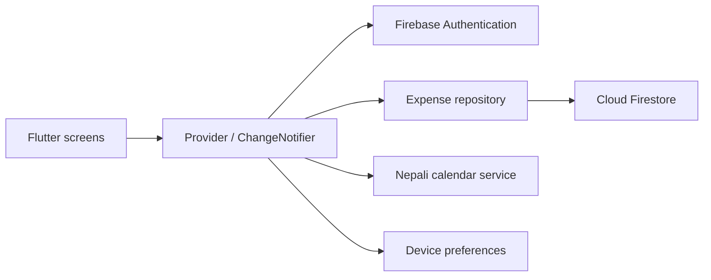

<div align="center">

# Pocket

### Personal finance for everyday life in Nepal

Track income, manage expenses, and review your month in English or Nepali.

[](https://github.com/bibasshrestha980-npl/expense_tracker/actions/workflows/ci.yml)
[](https://github.com/bibasshrestha980-npl/expense_tracker/actions/workflows/security.yml)


[](LICENSE)

[Preview](#screenshots) &nbsp; / &nbsp; [Features](#features) &nbsp; / &nbsp; [Setup](#run-locally) &nbsp; / &nbsp; [Architecture](#architecture) &nbsp; / &nbsp; [Security](#security)

</div>

---

An expense tracker built with Flutter, Provider, and Firebase. It supports Nepali rupees, BS and AD dates, and English and Nepali interfaces.

This is a final-project app for recording daily spending and income, reviewing monthly totals, and keeping transactions under a signed-in account.

## Screenshots

| Light mode | Dark mode |
| --- | --- |
|  |  |

Screenshots use sample transactions. Open either image for a closer look. Appearance and language preferences are available in Settings.

## Features

| Area | Included |
| --- | --- |
| **Transactions** | Record income and expenses, add categories and notes, search, edit, and delete entries. |
| **Overview** | Review income, spending, balance, and recent activity. |
| **Insights** | Compare category totals and monthly spending patterns. |
| **Calendar** | Browse BS and AD dates, with event details where source data is available. |
| **Language** | Switch between English and Nepali. |
| **Appearance** | Choose light, dark, or system mode, with preferences saved on the device. |
| **Reports** | Copy a financial summary or monthly transaction CSV to the clipboard. |
| **Accounts** | Email/password, Google, and guest sign-in, depending on Firebase configuration. |
| **Account management** | Email verification, password reset, and account deletion. |

Amounts are stored as integer paisa. Provider manages app state, and Firestore stores transactions under each user's account.

### Using Pocket

Record money received with **Add money**, then add your daily expenses. Check Overview for the balance, find individual records in Transactions, and open Insights to review spending by category. Calendar and language preferences can be changed without changing the underlying transactions.

## Run locally

### Prerequisites

| Tool | Requirement |
| --- | --- |
| Flutter | A release with Dart **3.13 or later**, matching [pubspec.yaml](pubspec.yaml) |
| Firebase | Your own project, Firebase CLI, and FlutterFire CLI |
| Web | Chrome for local development |
| Mobile | Configured Android tooling, or macOS and Xcode for iOS |

### 1. Get the source

```sh
git clone https://github.com/bibasshrestha980-npl/expense_tracker.git
cd expense_tracker
flutter pub get
```

### 2. Connect Firebase

```sh
firebase login
flutterfire configure --project=YOUR_PROJECT_ID
```

In Firebase Console:

1. Create a Cloud Firestore database.
2. Enable **Email/Password** in Authentication.
3. Enable **Google** and **Anonymous** if you want those sign-in options.
4. Configure authorized domains for web and platform settings for Google sign-in.
5. Review the verification email template. Email/password users open the emailed link and return to Pocket to confirm verification.

The checked-in Firebase files identify the original project. Replace them through FlutterFire when setting up your own deployment.

```sh
firebase deploy --only firestore:rules --project=YOUR_PROJECT_ID
```

### 3. Start the app

```sh
flutter run -d chrome
```

For Android or iOS, find your device with `flutter devices`, then run `flutter run -d DEVICE_ID`. iOS builds require macOS and Xcode. Platform-specific Firebase setup is required.

## Testing and builds

```sh
flutter analyze
flutter test
flutter build web
```

The web build is written to `build/web`; it is not deployed automatically. Firestore rule tests and App Check setup are covered in the [security guide](docs/SECURITY.md).

To run the access-control tests, make sure Node.js, Java, and Firebase CLI are available:

```sh
npm ci --prefix security
firebase emulators:exec --only firestore --project demo-pocket-security --config firebase.security.json "npm --prefix security test"
```

The rules suite checks unauthorized access, cross-account operations, malformed writes, and conversion of older encrypted records. It uses a local demo project, not production data. GitHub Actions runs Flutter checks and database-rule tests in separate workflows; the badges above show their current results.

## Architecture

Screens render state exposed by providers. Transaction providers use a repository for Firestore reads and writes. Authentication, external calendar data, and device preferences have separate responsibilities.



## Project structure

| Folder | Contents |
| --- | --- |
| `lib/models` | Transactions and calendar models |
| `lib/providers` | Authentication, preferences, and application state |
| `lib/screens` | Screens and forms |
| `lib/services` | Firestore access, calendar integration, and account deletion |
| `lib/l10n` | English and Nepali translations |
| `test` | Flutter tests |
| `security` | Firestore rule tests |

### Transaction storage

Records live at `users/{uid}/expenses/{expenseId}`. Each transaction contains a title, category, amount, date, note, and income/expense type. Integer paisa keeps totals consistent without floating-point rounding. Firestore rules validate document fields and restrict access to the authenticated owner.

## Security

Pocket uses authentication, owner-only database access, and document validation. Standard account storage is **not end-to-end encrypted**; authorized project administrators can read stored transaction fields.

App Check integration is included, but production provider registration and server-side enforcement still need configuration. No network firewall is installed by the app.

Read the [security and deployment guide](docs/SECURITY.md) for the full setup and boundaries. Report vulnerabilities according to [SECURITY.md](SECURITY.md).

## Things to know

Calendar event data may be missing for some dates. Your transactions do not depend on that data.

New accounts do not need a recovery key. An older version encrypted transactions with a separate key; those records still need the original key once to convert them safely. See the [security guide](docs/SECURITY.md) for details and the remaining App Check setup.

Guest accounts are not a substitute for a permanent sign-in. Account deletion happens in several steps, so a network failure may leave it partially complete. Android and iOS targets are included, but not every authentication flow has been verified on every platform.

For setup problems, see [Troubleshooting](docs/TROUBLESHOOTING.md). For fixes or suggestions, read [Contributing](CONTRIBUTING.md).

## Credits and license

Calendar data integration uses [bibhuticoder/nepali-calendar-api](https://github.com/bibhuticoder/nepali-calendar-api), with BS date utilities from `nepali_utils`.

[MIT license](LICENSE).
